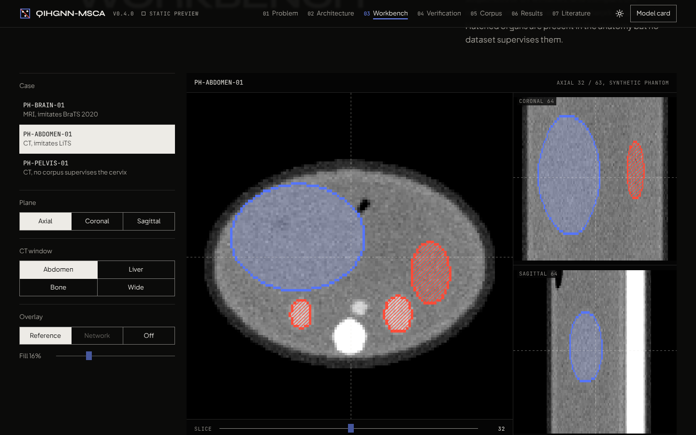
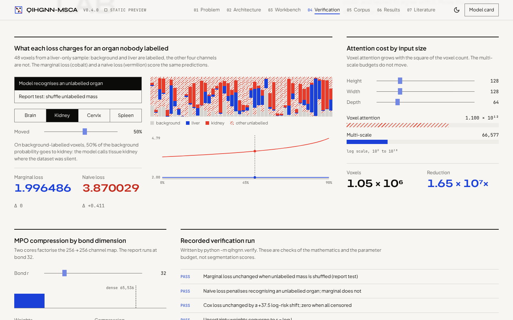

# QIHGNN-MSCA

**Brain tumour detection, outlining and prognosis that runs privately in the browser, built on a research model for partially supervised multi-organ segmentation.**

Upload a brain MRI and get:

- **a tumour check**: no tumour, glioma, meningioma, pituitary tumour, or "not a brain MRI", with calibrated confidence and abstention when unsure;
- **an outline**: the tumour drawn on the scan, and its volume in cm³ for a 3D NIfTI scan;
- **an explanation**: a class-activation heat map of the evidence;
- **a prognosis**: a survival curve for glioma from age, tumour volume and extent of surgery, with a bootstrap uncertainty band.

The models run in the visitor's browser through ONNX Runtime Web, so scans are never uploaded. Every figure on the site is measured on held-out patients, on duplicate-free splits, and on an independent dataset.

**Live site:** https://aninditamondal303.github.io/QIHGNN-MSCA-Quantum-Inspired-Hypergraph-Neural-Network-for-Multi-Organ-Segmentation-Prognosis/


> Research and education only. Not a medical device and not for diagnosis or treatment.

A project by Anindita Mondal.

---

## What is in the box

| Part | What it does | Where |
|---|---|---|
| Screening models | EfficientNet-B0 classifier (5 classes, temperature-calibrated, CAM), 2D U-Net tumour segmenter, Cox survival model with 200 bootstrap refits | `ml/qihgnn/screen/` |
| Honest evaluation | Flip/rotation-invariant near-duplicate clustering, group-level splits, external test set, Wilson intervals, calibration error, abstention coverage | `ml/qihgnn/screen/common.py`, `train.py` |
| In-browser inference | ONNX export with PyTorch parity check; preprocessing, NIfTI reader and survival maths in TypeScript, unit-tested against the Python outputs | `web/src/lib/screen.ts`, `web/tests/screen.test.ts` |
| Research model | 8-stage 3D PyTorch network, 8,347,071 parameters, equal to the project report stage by stage | `ml/qihgnn/model/` |
| Objective | Marginal + exclusion + Cox partial likelihood + discrete-horizon loss under learned uncertainty weighting | `ml/qihgnn/losses.py` |
| Verification | Pure-NumPy reproduction of every claimed property, written to `results/verification.json` | `ml/qihgnn/verify.py`, `ml/qihgnn/reference.py` |
| Data | Inspection before assumption, admission rules, preprocessing, patient-level splits, survival parsing | `ml/qihgnn/data/` |
| Training | Kaggle GPU kernels driven from VS Code tasks (`scripts/kaggle_run.ps1`), resumable, time-budgeted | `kaggle/`, `ml/qihgnn/train.py` |
| API | Starlette + pydantic: research-model inference and the built site | `api/app.py` |
| Website | Multi-page React + TypeScript + Tailwind v4 site: Home, Analyse, How it works, Accuracy, Data & privacy, About | `web/` |

## The idea in one picture

Each public dataset labels a single organ. A naive loss treats every unlabelled organ as background, so the model is punished for recognising a liver in a brain scan. The marginal loss folds unlabelled channels into background before scoring:

```
naive      [ background | brain | liver | kidney | cervix | spleen ]  every non-labelled guess is an error
marginal   [ background + liver + kidney + cervix + spleen | brain ]  unlabelled mass costs nothing
```

Measured in `results/verification.json`: when the model hands half the background probability on unlabelled voxels to an organ the dataset never annotated, the naive loss rises by **0.68** and the marginal loss changes by **0.00**.

## Architecture

| # | Stage | Output | Parameters |
|---|---|---|---:|
| 1 | Input: 4 MRI sequences or 4 CT windows | B × 4 × 128 × 128 × 64 | 0 |
| 2 | 3D residual encoder, instance norm | B × 256 × 16 × 16 × 8 | 3,559,808 |
| 3 | **Matrix product operator** (two cores, bond 32) | same | 17,152 |
| 4 | **Hypergraph convolution** (256 nodes, 5 organ hyperedges, learned incidence) | same | 232,468 |
| 5 | **Multi-scale cross-attention** (token budgets 256 / 32 / 4 / 1) | same | 2,108,160 |
| 6 | Shared representation | B × 512 | 132,608 |
| 7 | Segmentation decoder + prognosis MLP | B × 6 × 128 × 128 × 64, B × 5 | 2,296,875 |
| 8 | Serving: zero every channel no dataset supervised | mask, risk, 1/3/5-year survival | 0 |
| | **Total** | 31.84 MB at fp32 | **8,347,071** |

Attention cost is Σ n² = 66,577 entries per sample against 1.1 × 10¹² for voxel attention, and it does not change with input size. The MPO compresses the 256 → 256 channel map 4× at bond 32. Both are reproduced by tests and are live instruments on the website.

## Quick start (Windows, VS Code)

Requirements: Python 3.11 or 3.12, Node.js 20 or newer, Git, VS Code.

```powershell
git clone https://github.com/<you>/qihgnn-msca.git
cd qihgnn-msca
code .
```

In VS Code: **Terminal → Run Task → `Windows: one-time setup`**, then **`Windows: run all checks`** (verification, every test including the PyTorch model, a smoke training run, the website build and the browser test). Then run **`Start everything`** and open http://localhost:5173.

Or by hand in PowerShell:

```powershell
py -3 -m venv .venv
.venv\Scripts\python -m pip install torch --index-url https://download.pytorch.org/whl/cpu
.venv\Scripts\python -m pip install -r ml\requirements-dev.txt
cd web; npm install; npm run build; cd ..

# terminal 1: API on :8765 (also serves the built site at http://localhost:8765)
.venv\Scripts\python -m uvicorn api.app:app --port 8765
# terminal 2: website with live reload on :5173 (proxies /api to :8765)
cd web; npm run dev
```

macOS or Linux: `make setup`, then `make api` and `make web` in two terminals.

With an NVIDIA GPU, install the CUDA build of PyTorch instead (for example `--index-url https://download.pytorch.org/whl/cu124`).

## Tests

```powershell
.venv\Scripts\python -m pytest          # 55+ tests: verification, data, model, API (42 run without PyTorch)
cd web
npm test                                 # TypeScript formulas checked against Python fixtures
npm run typecheck                        # strict TypeScript
npm run build; npm run test:e2e          # Chromium end to end, desktop and 360 px
```

What the suites prove:

- The parameter budget equals the report for every stage, from an independent pure-Python counter, and the PyTorch model matches that counter exactly (`test_parameter_count_matches_analytical_counter`).
- The marginal loss gives zero gradient to unsupervised channels; the naive loss penalises correct predictions of unlabelled organs.
- The Cox loss is invariant to a constant log-risk shift and exactly zero when every case is censored; censored horizons are skipped, not defaulted.
- Dice, HD95, C-index and time-dependent AUC match closed forms.
- No patient appears in two splits.
- The server never returns a channel that no dataset supervised.
- The browser formulas agree with Python to 1e-9, the site has no horizontal scroll at 360 px, and every interactive section works in a real browser.

CI runs all of it on every push (`.github/workflows/ci.yml`), including a smoke training run.

## From data to results

```powershell
python scripts/download_data.py               # needs a Kaggle API token, see the script header
cd ml
python -m qihgnn.data.inspection              # reads every dataset, decides what may supervise what
python -m qihgnn.data.cache                   # preprocess once to 128 x 128 x 64, patient-level splits
python -m qihgnn.train --config configs/smoke.json    # minutes on CPU, synthetic phantoms, proves the loop runs
python -m qihgnn.train --config configs/full.json     # 200 epochs (GPU)
python -m qihgnn.train --config configs/baseline.json # matched baseline; also ablate_mpo / ablate_hypergraph / ablate_msca
python -m qihgnn.evaluate --checkpoint ..\runs\<full>\best.pt ..\runs\<baseline>\best.pt --label full baseline
python -m qihgnn.export_web                   # the website now shows the measured scores
```

No GPU? `notebooks/train_on_kaggle.ipynb` runs the whole pipeline on a free Kaggle GPU with the datasets attached, and packs the results for download.

### Dataset admission rules

A dataset may supervise an organ only if it provides pixel-level masks for that organ in volumetric CT or MRI. `qihgnn.data.inspection` applies this automatically and writes its reasons to `data/inspection_report.json`:

- **BraTS 2020**: admitted for the brain channel (whole tumour). If `survival_info.csv` is present, the prognosis head trains on real right-censored survival data.
- **LiTS**: admitted for the liver channel (liver and tumour merged).
- **Cervical cancer segmentation**: admitted for the cervix only if it holds volumetric images with masks. 2D colposcopy or cytology images are rejected for the 3D network, for the same reason the report rejected SipakMed. The cervix then stays unsupervised and is suppressed at inference.
- **KiTS19** is in the report but not in the current dataset list, so kidney is unsupervised until it is added.

## Results

All figures are on held-out data: patients (BraTS), CT volumes, slides, or near-duplicate clusters never seen in training. 95% Wilson intervals in brackets. Source: `web/public/screen/screen_metrics.json`, produced by `python -m qihgnn.screen.train` on a Kaggle T4.

### Brain MRI: tumour check (1596 test images)

| Measure | Value |
|---|---|
| 5-class accuracy (no tumour, glioma, meningioma, pituitary, not a brain MRI) | **97.4%** (96.5–98.0%), macro F1 0.974 |
| Tumours detected (sensitivity) | **98.4%** (97.4–99.0%) |
| Tumour-free scans cleared (specificity) | **98.8%** (97.0–99.5%) |
| Tumour vs no tumour, ROC AUC | 0.9935 |
| Per-class recall | no tumour 98.8%, glioma 96.0%, meningioma 92.7%, pituitary 99.6%, not a brain MRI 100.0% |
| Calibration error (ECE) | 1.2% after temperature scaling (3.7% before) |
| Abstention | answers 98.5% of images (confidence ≥ 0.74) and is right on 98.0% of those |
| Independent dataset (Brain MRI Images for Brain Tumor Detection) | 108 tumour images: sensitivity 75.9% (67.1–83.0%), AUC 0.986; only 2 tumour-free images survive de-duplication, too few for specificity |

**Leakage in the public split.** 935 of the dataset's 1600 official test images have a near-identical copy (perceptual hash, including flips and rotations) in its training folder; 4309 of 7200 images sit in 1303 duplicate clusters. Splitting by cluster removes that inflation.

### Brain MRI: outline and volume (BraTS 2020, 52 test patients)

| Measure | Value |
|---|---|
| Dice on tumour slices, by input sequence | FLAIR 0.674, T2 0.622, T1 0.534, T1ce 0.504 |
| False alarms on tumour-free slices | 1.4%–4.3% |
| Whole-volume Dice (T2, slice by slice) | **0.749** |
| Whole-tumour volume error (T2) | median 8.9 cm³ (13.6%), r = 0.957 |
| Skull-on contrast T1 slices (figshare) | Dice 0.704 (image-level split; no patient IDs) |

### Brain MRI: prognosis (BraTS 2020 survival, 236 patients, 235 deaths)

| Model | Cross-validated C-index |
|---|---|
| Age, tumour volume, extent of resection | **0.634** ± 0.038 |
| Age only | 0.621 |
| Age and resection | 0.625 |
| Tumour volume only | 0.558 |

Out-of-fold risk thirds separate clearly (log-rank p = 1.7e-06), but assigning BraTS survival classes is no better than the majority class (37.9% vs 37.9%). The tool therefore reports a risk ranking and a survival curve with its bootstrap band, not a predicted survival class.

### Cervical cell analysis (686 images from 524 slides, 100 held-out images from unseen slides)

| Measure | Value |
|---|---|
| Nucleus outline Dice | **0.751** (median 0.771) |
| Cell outline Dice | **0.877** (median 0.886) |
| Nuclei per image, error against the expert count | median 5 (mean 7.0), r = 0.904 |
| Median nucleus-to-cytoplasm ratio per image, error | median 0.004, r = 0.928 |

The data has cell and nucleus outlines but no diagnosis labels, so the tool measures; it does not grade the cells. Cells whose N:C ratio is above the 99th percentile of the training slides (0.24) are flagged for a cytologist to look at.

### Liver CT (LiTS, 131 original CT scans; 25 held-out patients, every slice)

Two networks in sequence: one finds the liver on each slice; the second looks only at a square around the liver, cropped from the scan at full resolution, and outlines tumours. Trained on the original CT volumes (Hounsfield units, real voxel sizes, lossless expert masks), split by patient.

| Measure | Value |
|---|---|
| Liver Dice, whole scan | **0.950** (median 0.952) |
| Liver volume against the expert | median error 3.4%, r = 0.989 |
| Tumour Dice, whole scan | 0.422 (median 0.426; 22 patients with tumours) |
| Lesions found | 81% (75 of 93); 93% of larger lesions, 75% of small ones |
| False lesions per patient | mean 2.1, median 1 |
| Liver slices: tumour present or not | sensitivity 63.8%, specificity 95.3%, AUC 0.809 (3,250 slices) |

Weak spot: very large tumours can be badly under-measured (two test patients: 346 vs 69 cm³ and 266 vs 2 cm³), so tumour volume correlates with the expert at only r = 0.51. An earlier attempt on a JPEG copy of the same data reached tumour Dice 0.26; its masks were full of compression specks, which is why the original scans are used.

### Research model (3D QIHGNN-MSCA)

Held-out test patients (53 brain, 19 liver, 30 with survival data); 30 epochs each on one Kaggle T4. The baseline is the same network with the MPO layers, the hypergraph and multi-scale cross-attention removed, trained the same way.

| Measure | QIHGNN-MSCA | Matched baseline |
|---|---|---|
| Brain lesion Dice / HD95 (voxels) | **0.877** ± 0.06 / 2.9 | 0.419 ± 0.19 / 34.6 |
| Liver Dice / HD95 (voxels) | **0.791** ± 0.20 / 5.3 | 0.037 ± 0.02 / 75.2 |
| Survival C-index | **0.714** | 0.661 |
| Time-dependent AUC, 1 / 3 years | 0.786 / 0.778 | 0.705 / 0.889 |

The mathematics of the objective, the parameter budget, attention cost and MPO compression are checked separately: 9/9 checks passing (`results/verification.json`). With 30 survival cases the C-index and AUC intervals are wide; the 3-year AUC favours the baseline.

## Website design notes

The site is built as an editorial research archive, not a landing page.

- **One signature device:** vermilion diagonal hatching always means *silence*, a channel no dataset supervises. It marks suppressed organs in the scan viewer, the supervision matrix, the loss instrument and the empty result cells. Cobalt always means *supervised*.
- **Scans on film:** scan panels stay lightbox-black in both themes, as in a reading room. The viewer reads 3D volumes from lossless PNG mosaics and renders voxel-exact contours on a canvas, in axial, coronal and sagittal planes with a linked crosshair.
- **Type:** Syne Bold (display, sized with container-query units so the headline always fills its column), Plus Jakarta Sans (text), JetBrains Mono (data). All fonts are self-hosted.
- **Motion:** one moment only, the hero slice developing like film on first load. Everything else moves only in response to input, and `prefers-reduced-motion` is respected.
- **Honesty in the interface:** results that do not exist are shown as designed empty states with the command that produces them.




## Repository layout

```
ml/qihgnn/          model, losses, reference maths, verification, data pipeline, training, evaluation, serving
ml/tests/           pytest suites (torch tests skip themselves when torch is absent)
ml/configs/         smoke, dev, full, baseline and ablation configs
api/                Starlette app and tests
web/src/            React components, TypeScript ports of the formulas, design tokens in styles.css
web/scripts/        esbuild + Tailwind build and the dev server with API proxy
web/tests/          unit tests (node:test via tsx) and the Playwright end-to-end script
scripts/            Kaggle download
notebooks/          Kaggle GPU training notebook
docs/               decisions log, model card, screenshots
results/            verification.json (committed); metrics.json after evaluation
```

## Deploy

- **Static site on GitHub Pages:** push to `main`; `.github/workflows/pages.yml` publishes `web/` (repository must be public on a free plan).
- **Website + API in one container:** `docker build -t qihgnn-msca . && docker run -p 7860:7860 qihgnn-msca`. The same `Dockerfile` runs on Hugging Face Spaces, Render, Railway and Fly.io.

Step-by-step instructions: [`docs/DEPLOY.md`](docs/DEPLOY.md).

## Further reading

- [`docs/DECISIONS.md`](docs/DECISIONS.md): every place this implementation chooses something the report leaves open, and why.
- [`docs/MODEL_CARD.md`](docs/MODEL_CARD.md): intended use, data, evaluation, limitations.

## Licences

Fonts: SIL Open Font License (`web/public/fonts/OFL-*.txt`). Datasets are used under their own terms; check them before publishing any real scan. Choose a licence for the code before making the repository public.
