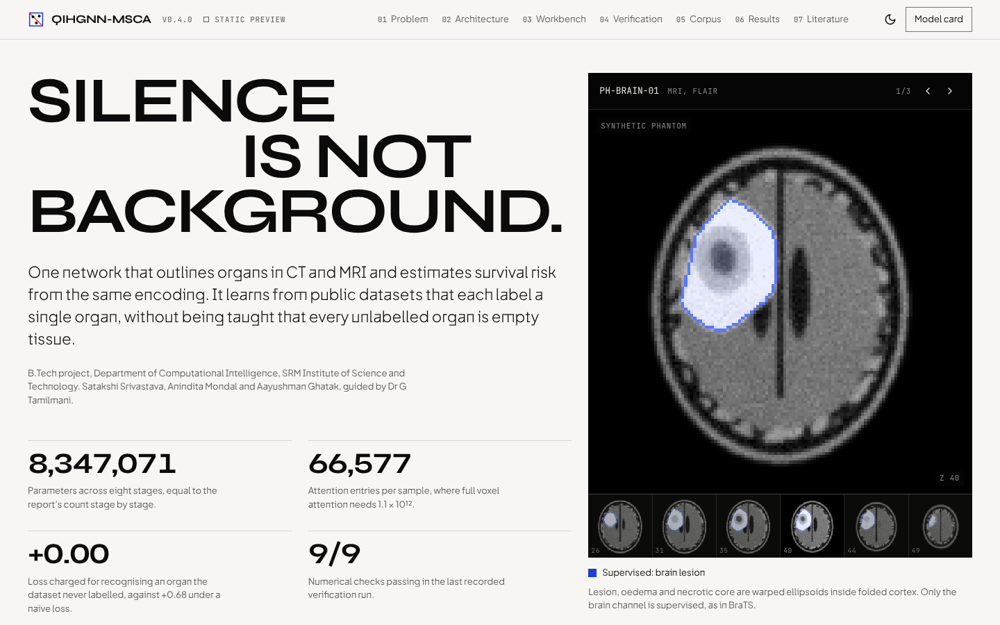

# QIHGNN-MSCA

**Quantum-inspired hypergraph neural network with multi-scale cross-attention for partially supervised multi-organ segmentation and prognosis.**

One 3D network that outlines organs in CT and MRI and estimates survival risk from a single shared encoding. It trains on public datasets that each label only one organ, without being taught that every unlabelled organ is background. The repository contains the model, a fully tested numerical verification of every property the project report claims, a data pipeline for the three Kaggle datasets, an HTTP API, and an editorial research website with an interactive scan workbench.



> Research prototype. Not a medical device and not for clinical use. The scans shown on the website are synthetic phantoms generated in code.

B.Tech project, Department of Computational Intelligence, SRM Institute of Science and Technology.
Satakshi Srivastava, Anindita Mondal and Aayushman Ghatak, guided by Dr G Tamilmani.

---

## What is in the box

| Part | What it does | Where |
|---|---|---|
| Model | 8-stage PyTorch network, 8,347,071 parameters, equal to the report stage by stage | `ml/qihgnn/model/` |
| Objective | Marginal + exclusion + Cox partial likelihood + discrete-horizon loss under learned uncertainty weighting | `ml/qihgnn/losses.py` |
| Verification | Pure-NumPy reproduction of every claimed property, written to `results/verification.json` | `ml/qihgnn/verify.py`, `ml/qihgnn/reference.py` |
| Data | Inspection before assumption, admission rules, preprocessing, patient-level splits, survival parsing | `ml/qihgnn/data/` |
| Training | AdamW, warmup + cosine, AMP, gradient accumulation, event-aware sampler, resumable checkpoints | `ml/qihgnn/train.py` |
| Evaluation | Per-organ Dice and HD95, C-index, time-dependent AUC, matched baseline and three ablations | `ml/qihgnn/evaluate.py` |
| API | Starlette + pydantic, inference with unsupervised-channel suppression | `api/app.py` |
| Website | React + TypeScript + Tailwind v4, esbuild, KaTeX, canvas volume viewer | `web/` |

## The idea in one picture

Each public dataset labels a single organ. A naive loss treats every unlabelled organ as background, so the model is punished for recognising a liver in a brain scan. The marginal loss folds unlabelled channels into background before scoring:

```
naive      [ background | brain | liver | kidney | cervix | spleen ]  every non-labelled guess is an error
marginal   [ background + liver + kidney + cervix + spleen | brain ]  unlabelled mass costs nothing
```

Measured in `results/verification.json`: when the model hands half the background probability on unlabelled voxels to an organ the dataset never annotated, the naive loss rises by **0.68** and the marginal loss changes by **0.00**.

## Architecture

| # | Stage | Output | Parameters |
|---|---|---|---:|
| 1 | Input: 4 MRI sequences or 4 CT windows | B × 4 × 128 × 128 × 64 | 0 |
| 2 | 3D residual encoder, instance norm | B × 256 × 16 × 16 × 8 | 3,559,808 |
| 3 | **Matrix product operator** (two cores, bond 32) | same | 17,152 |
| 4 | **Hypergraph convolution** (256 nodes, 5 organ hyperedges, learned incidence) | same | 232,468 |
| 5 | **Multi-scale cross-attention** (token budgets 256 / 32 / 4 / 1) | same | 2,108,160 |
| 6 | Shared representation | B × 512 | 132,608 |
| 7 | Segmentation decoder + prognosis MLP | B × 6 × 128 × 128 × 64, B × 5 | 2,296,875 |
| 8 | Serving: zero every channel no dataset supervised | mask, risk, 1/3/5-year survival | 0 |
| | **Total** | 31.84 MB at fp32 | **8,347,071** |

Attention cost is Σ n² = 66,577 entries per sample against 1.1 × 10¹² for voxel attention, and it does not change with input size. The MPO compresses the 256 → 256 channel map 4× at bond 32. Both are reproduced by tests and are live instruments on the website.

## Quick start (Windows, VS Code)

Requirements: Python 3.11 or 3.12, Node.js 20 or newer, Git, VS Code.

```powershell
git clone https://github.com/<you>/qihgnn-msca.git
cd qihgnn-msca
code .
```

In VS Code: **Terminal → Run Task → `Windows: one-time setup`**, then **`Windows: run all checks`** (verification, every test including the PyTorch model, a smoke training run, the website build and the browser test). Then run **`Start everything`** and open http://localhost:5173.

Or by hand in PowerShell:

```powershell
py -3 -m venv .venv
.venv\Scripts\python -m pip install torch --index-url https://download.pytorch.org/whl/cpu
.venv\Scripts\python -m pip install -r ml\requirements-dev.txt
cd web; npm install; npm run build; cd ..

# terminal 1: API on :8765 (also serves the built site at http://localhost:8765)
.venv\Scripts\python -m uvicorn api.app:app --port 8765
# terminal 2: website with live reload on :5173 (proxies /api to :8765)
cd web; npm run dev
```

macOS or Linux: `make setup`, then `make api` and `make web` in two terminals.

With an NVIDIA GPU, install the CUDA build of PyTorch instead (for example `--index-url https://download.pytorch.org/whl/cu124`).

## Tests

```powershell
.venv\Scripts\python -m pytest          # 55+ tests: verification, data, model, API (42 run without PyTorch)
cd web
npm test                                 # TypeScript formulas checked against Python fixtures
npm run typecheck                        # strict TypeScript
npm run build; npm run test:e2e          # Chromium end to end, desktop and 360 px
```

What the suites prove:

- The parameter budget equals the report for every stage, from an independent pure-Python counter, and the PyTorch model matches that counter exactly (`test_parameter_count_matches_analytical_counter`).
- The marginal loss gives zero gradient to unsupervised channels; the naive loss penalises correct predictions of unlabelled organs.
- The Cox loss is invariant to a constant log-risk shift and exactly zero when every case is censored; censored horizons are skipped, not defaulted.
- Dice, HD95, C-index and time-dependent AUC match closed forms.
- No patient appears in two splits.
- The server never returns a channel that no dataset supervised.
- The browser formulas agree with Python to 1e-9, the site has no horizontal scroll at 360 px, and every interactive section works in a real browser.

CI runs all of it on every push (`.github/workflows/ci.yml`), including a smoke training run.

## From data to results

```powershell
python scripts/download_data.py               # needs a Kaggle API token, see the script header
cd ml
python -m qihgnn.data.inspection              # reads every dataset, decides what may supervise what
python -m qihgnn.data.cache                   # preprocess once to 128 x 128 x 64, patient-level splits
python -m qihgnn.train --config configs/smoke.json    # minutes on CPU, synthetic phantoms, proves the loop runs
python -m qihgnn.train --config configs/full.json     # 200 epochs (GPU)
python -m qihgnn.train --config configs/baseline.json # matched baseline; also ablate_mpo / ablate_hypergraph / ablate_msca
python -m qihgnn.evaluate --checkpoint ..\runs\<full>\best.pt ..\runs\<baseline>\best.pt --label full baseline
python -m qihgnn.export_web                   # the website now shows the measured scores
```

No GPU? `notebooks/train_on_kaggle.ipynb` runs the whole pipeline on a free Kaggle GPU with the datasets attached, and packs the results for download.

### Dataset admission rules

A dataset may supervise an organ only if it provides pixel-level masks for that organ in volumetric CT or MRI. `qihgnn.data.inspection` applies this automatically and writes its reasons to `data/inspection_report.json`:

- **BraTS 2020**: admitted for the brain channel (whole tumour). If `survival_info.csv` is present, the prognosis head trains on real right-censored survival data.
- **LiTS**: admitted for the liver channel (liver and tumour merged).
- **Cervical cancer segmentation**: admitted for the cervix only if it holds volumetric images with masks. 2D colposcopy or cytology images are rejected for the 3D network, for the same reason the report rejected SipakMed. The cervix then stays unsupervised and is suppressed at inference.
- **KiTS19** is in the report but not in the current dataset list, so kidney is unsupervised until it is added.

## Results

| | Status |
|---|---|
| Mathematics of the objective, parameter budget, attention cost, MPO compression | **Measured**, 9/9 checks passing (`results/verification.json`) |
| Per-organ Dice, HD95, C-index, time-dependent AUC | **Not yet measured.** Filled in by `qihgnn.evaluate` after a converged run |

The site and the API never show a segmentation or prognosis number that the evaluation script has not written. The report's preliminary Dice of 0.173 came from a short, unconverged run and is not reproduced here.

## Website design notes

The site is built as an editorial research archive, not a landing page.

- **One signature device:** vermilion diagonal hatching always means *silence*, a channel no dataset supervises. It marks suppressed organs in the scan viewer, the supervision matrix, the loss instrument and the empty result cells. Cobalt always means *supervised*.
- **Scans on film:** scan panels stay lightbox-black in both themes, as in a reading room. The viewer reads 3D volumes from lossless PNG mosaics and renders voxel-exact contours on a canvas, in axial, coronal and sagittal planes with a linked crosshair.
- **Type:** Syne Bold (display, sized with container-query units so the headline always fills its column), Plus Jakarta Sans (text), JetBrains Mono (data). All fonts are self-hosted.
- **Motion:** one moment only, the hero slice developing like film on first load. Everything else moves only in response to input, and `prefers-reduced-motion` is respected.
- **Honesty in the interface:** results that do not exist are shown as designed empty states with the command that produces them.


## Repository layout

```
ml/qihgnn/          model, losses, reference maths, verification, data pipeline, training, evaluation, serving
ml/tests/           pytest suites (torch tests skip themselves when torch is absent)
ml/configs/         smoke, dev, full, baseline and ablation configs
api/                Starlette app and tests
web/src/            React components, TypeScript ports of the formulas, design tokens in styles.css
web/scripts/        esbuild + Tailwind build and the dev server with API proxy
web/tests/          unit tests (node:test via tsx) and the Playwright end-to-end script
scripts/            Kaggle download
notebooks/          Kaggle GPU training notebook
docs/               decisions log, model card, screenshots
results/            verification.json (committed); metrics.json after evaluation
```

## Further reading

- [`docs/DECISIONS.md`](docs/DECISIONS.md): every place this implementation chooses something the report leaves open, and why.
- [`docs/MODEL_CARD.md`](docs/MODEL_CARD.md): intended use, data, evaluation, limitations.

## Licences

Fonts: SIL Open Font License (`web/public/fonts/OFL-*.txt`). Datasets are used under their own terms; check them before publishing any real scan. Choose a licence for the code before making the repository public.
